# Olá, eu sou a Nayelly Roberta

**Desenvolvedora Full Stack Júnior** · Laravel · React · PHP · PostgreSQL  
Tecnóloga em Análise e Desenvolvimento de Sistemas e cursando **Sistemas de Informação** na UniFAP · Juazeiro do Norte, CE

## Sobre mim

- Desenvolvedora Full Stack e **Líder de Projeto** no **NexTI UniFAP**, onde lidero uma equipe de 3 devs na criação de um sistema de gestão de projetos
- Desenvolvi o front e o back-end de um sistema de gerenciamento de demandas internas (React, Tailwind, Laravel, PostgreSQL, Docker)
- Gosto de unir código, UX e requisitos bem entendidos: bom software começa antes do código
- Co-conduzi o workshop *Descodificando Requisitos* (engenharia de requisitos e Scrum na prática)
- Aberta a oportunidades como **Desenvolvedora Full Stack Júnior** (presencial, híbrido ou remoto)

## Stack

**Métodos:** Scrum · Kanban · Levantamento de requisitos · Code review

## Projetos em destaque

| Projeto | O que é | Stack |
|---|---|---|
| [helpbot-react-native](https://github.com/NayellySilva/helpbot-react-native) | App mobile de chatbot com IA: chat em tempo real integrado a uma API de linguagem natural | React Native · Expo · OpenRouter API |
| [filmes-mobile](https://github.com/NayellySilva/filmes-mobile) | App mobile de catálogo de filmes, com lista, tela de detalhes e backend fake consumido via Axios | React Native · TypeScript · Axios |
| [Mask-Game](https://github.com/NayellySilva/Mask-Game) | Jogo da memória “Máscaras do Nordeste”, criado em equipe na Global Game Jam — [jogar online](https://mask-game.vercel.app) | Vue.js |

> No NexTI UniFAP desenvolvi o **Sistema de Gerenciamento de Demandas** (front em React + Tailwind, back em Laravel + PostgreSQL, ambiente em Docker). O código é privado da instituição.

## Contato

<picture data-importer="pacman">
  <source media="(prefers-color-scheme: dark)" srcset="https://raw.githubusercontent.com/NayellySilva/NayellySilva/pacman-output/bomberman-contribution-graph-dark.svg?game=bomberman">
  <source media="(prefers-color-scheme: light)" srcset="https://raw.githubusercontent.com/NayellySilva/NayellySilva/pacman-output/bomberman-contribution-graph.svg?game=bomberman">
  
</picture>

###

